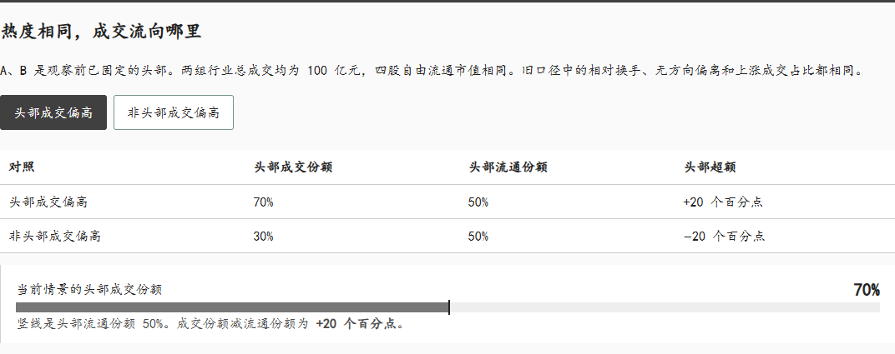

# A 股行业拥挤度研究

研究如何读懂一个行业的交易热度、成交集中方向和退出约束。覆盖沪深普通 A 股与申万 2021 一级行业口径。当前为 **v2 研究版**，整理日期为 **2026-11-24**。

## 先从哪里看

| 材料 | 内容 |
|---|---|
| [研究报告](docs/research.md#构建与呈现-v2) | v2 指标、数据覆盖、时点规则、开源对照、样本外检验设计 |
| [Excel 研究台账](artifacts/research-ledger.xlsx) | 打开「结构对照」，查看逐项计算。旧版综合分在「完整复算」 |
| [离线 HTML](demo/index.html) | 从 GitHub 下载原文件后用浏览器打开，可切换成交方向和分母情景 |
| [Python 复核脚本](scripts/check_examples.py) | 使用标准库复算教学数据 |

## v2 的四项读数

| 读数 | 定义或用途 |
|---|---|
| 行业热度 | 五日相对换手均值在行业自身过去 252 个交易日中的历史分位 |
| 头部成交超额 | 期初固定头部组的成交份额减自由流通市值份额，单位为百分点 |
| 非头部上涨广度 | 非头部正成交且收益有效股票中，上涨家数所占比例 |
| 退出约束 | 跌停或停牌等可卖性限制、下跌日价格冲击，以及有可见持仓时的容量估算 |

两组人工构造的股票成交在旧版因子上完全相同。它们的头部成交份额分别为 70% 和 30%，对照同一个 50% 流通份额，头部成交超额为 **+20** 和 **−20 个百分点**。这说明成交偏离的程度和方向需要两项读数。参数与门槛仍是研究设定，A 股样本外有效性待验证。

## 在本地复算

    python scripts/check_examples.py --self-test
    python scripts/check_examples.py --direction-example

演示和台账中的数据为合成样例。文献、开源项目与算式来源随正文和台账记录。
